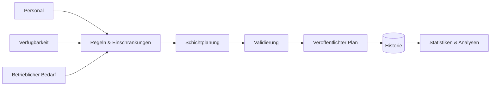

# Schichtplanung & Workforce Management System

### Regelbasierte Personaleinsatzplanung für komplexe kommunale Abläufe

<a href="./README.md">English</a> · <a href="./README.de.md"><strong>Deutsch</strong></a> · <a href="./README.tr.md">Türkçe</a>

  
  
  

---

## Überblick

Das Schichtplanungs- und Workforce-Management-System ist für operative Umgebungen konzipiert, in denen die Personaleinsatzplanung von vielen miteinander verknüpften Regeln, personellen Einschränkungen und organisatorischen Anforderungen bestimmt wird.

Anstatt Planung als reines Kalenderproblem zu behandeln, modelliert das System sie als Business-Rule- und Constraint-Management-Problem. Personaleinsatzplanung, Validierung, Historie und operative Transparenz werden in einem gemeinsamen Ablauf zusammengeführt.

## Zentrale Herausforderungen

Ein reales Workforce-System muss unter anderem folgende Fragen beantworten:

- Wer ist für eine bestimmte Schicht geeignet?
- Welche personellen und betrieblichen Regeln gelten?
- Welche Zuweisungen stehen im Konflikt mit bestehenden Einschränkungen?
- Wie soll die Arbeitslast verteilt werden?
- Welche historischen Informationen sind für die Planung relevant?
- Wie können Verantwortliche den resultierenden Dienstplan nachvollziehen?

## Planungsablauf

## Kernfunktionen

| Funktion | Zweck |
|---|---|
| **Schichtplanung** | Dienstpläne erstellen und verwalten |
| **Constraint Management** | Betriebliche und personelle Einschränkungen berücksichtigen |
| **Personalverwaltung** | Relevanten Mitarbeiterkontext während der Planung bereitstellen |
| **Arbeitslast-Bewertung** | Ausgewogene und fundierte Zuweisungsentscheidungen unterstützen |
| **Historische Nachverfolgung** | Frühere Zuweisungen und operativen Kontext bewahren |
| **Statistiken & Analysen** | Planungshistorie in operative Erkenntnisse umwandeln |
| **Administration** | Planungsworkflows für berechtigte Nutzer zentralisieren |

## Engineering-Fokus

Der Schwerpunkt des Projekts liegt auf der Modellierung einer regelintensiven operativen Domäne, die auch bei wachsender Komplexität verständlich und wartbar bleibt.

Wichtige Engineering-Themen sind:

- Modellierung von Business Rules
- Constraint-aware Scheduling
- Datenkonsistenz
- Validierungsabläufe
- Historische Datensätze
- Reporting und Analytics
- Wartbare Domänenarchitektur
- Administrative Workflow-Gestaltung

## Live Demo

Die bereitgestellte Anwendung kann direkt geöffnet werden:

### **[→ Shift Planning System öffnen](https://shift-planning-system-drab.vercel.app/takvim)**

Die Demo verwendet ausschließlich synthetische Nutzer und synthetische Planungsdaten. Im öffentlichen Deployment sind keine realen kommunalen Personaldaten enthalten.

## Daten & Datenschutz

Dieses Repository und die öffentliche Demo sind bewusst von realen operativen Personaldaten getrennt. Öffentliche Beispiele verwenden synthetische Daten, damit das System ohne Offenlegung privater Datensätze demonstriert werden kann.

---

### Entwickelt von [Taha Kubilay](https://github.com/tahakubilay)

`Workforce Management` · `Scheduling` · `Business Rules` · `Enterprise Software` · `Analytics`

