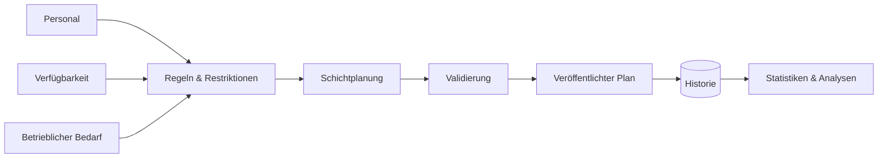

# Schichtplanung & Workforce Management System

### Regelbasierte Personaleinsatzplanung für komplexe kommunale Abläufe

<a href="./README.md">English</a> · <a href="./README.de.md"><strong>Deutsch</strong></a> · <a href="./README.tr.md">Türkçe</a>

  
  
  
  

---

## ✨ Auf einen Blick

| | |
|---|---|
| 🏛️ **Kontext** | Komplexe kommunale Personaleinsatzplanung |
| 🗓️ **Problem** | Schichtplanung unter vielen voneinander abhängigen Regeln und Restriktionen |
| 🧠 **Kernaufgabe** | Betriebliche Richtlinien in wartbare Planungslogik übersetzen |
| 📊 **Mehr als Planung** | Historie, Nachverfolgung, Statistiken und operative Transparenz |
| 🔐 **Öffentliche Version** | Ausschließlich synthetische Daten |
| 🚀 **Demo** | Geplante Portfolio-Sandbox |

## 🔎 Warum dieses System existiert

Ein normaler Kalender kann eine Person einer Schicht zuweisen.

Ein echtes Workforce-System muss deutlich schwierigere Fragen beantworten:

- **Wer ist für eine Schicht überhaupt zulässig?**
- **Welche Regeln gelten?**
- **Welche Zuweisungen kollidieren miteinander?**
- **Wie soll die Arbeitslast verteilt werden?**
- **Was ist historisch passiert?**
- **Können Verantwortliche die Planung nachvollziehen?**

Dadurch wird Schichtplanung zu einem **Constraint- und Business-Rule-Problem** statt zu einem einfachen CRUD-Workflow.

## ⚙️ Planungsablauf

## ⚡ Kernfunktionen

| Funktion | Zweck |
|---|---|
| 🗓️ **Schichtplanung** | Dienstpläne erstellen und verwalten |
| 🧩 **Constraint Handling** | Betriebliche und personelle Einschränkungen anwenden |
| 👥 **Personalverwaltung** | Relevanten Mitarbeiterkontext für Planer verfügbar machen |
| ⚖️ **Arbeitslast-Bewusstsein** | Fairere und fundiertere Zuweisungsentscheidungen unterstützen |
| 🕘 **Historische Nachverfolgung** | Frühere Zuweisungen und operativen Kontext bewahren |
| 📊 **Statistiken** | Planungshistorie in verwertbare Transparenz umwandeln |
| 🧑‍💼 **Administration** | Planungsworkflows für berechtigte Nutzer zentralisieren |

## 🧠 Engineering-Fokus

Der Wert dieses Projekts liegt in der Modellierung einer realen operativen Domäne.

Wichtige Engineering-Themen:

- Modellierung von Business Rules
- Constraint-aware Scheduling
- Datenkonsistenz
- Validierungsabläufe
- Historische Datensätze
- Reporting und Analytics
- Wartbare Domänenarchitektur
- Administrative Workflow-Gestaltung

> [!NOTE]
> Die öffentliche Version ist bewusst von realen kommunalen Personaldaten getrennt. Jede spätere Demo wird ausschließlich **synthetische Nutzer und synthetische Planungsdaten** enthalten.

## 🎬 Live Demo

**Kommt bald.**

Die öffentliche Demo ist als recruiter-freundliche Sandbox geplant, die repräsentative Regeln und Workflows zeigt, ohne Produktionsdaten offenzulegen.

## 🖼️ Produktvorschau

| Planung | Personal | Analytics |
|---|---|---|
| 🗓️ Demnächst | 👥 Demnächst | 📊 Demnächst |

Ein echter Workflow-GIF wird ergänzt, sobald der portfolio-sichere Build fertig ist.

## 🛣️ Projektstatus

- [x] Öffentliche Case-Study-Repository
- [x] Problem-/Lösungsdarstellung
- [x] Architekturübersicht der Planung
- [ ] Bereinigten Quellcode veröffentlichen
- [ ] Tatsächlichen Tech-Stack dokumentieren
- [ ] Screenshots ergänzen
- [ ] Workflow-GIF ergänzen
- [ ] Rule Engine / Domänenmodell dokumentieren
- [ ] Synthetische Demo deployen

## 💡 Warum dieses Projekt wichtig ist

Dieses Projekt zeigt die Fähigkeit, **unübersichtliche, regelintensive operative Anforderungen** in ein strukturiertes Softwaresystem zu überführen.

Es geht dabei über Formulare und Datenbanktabellen hinaus: Die Domäne muss verstanden, Constraints müssen modelliert und die Software so gestaltet werden, dass sie auch bei wachsender Komplexität verständlich bleibt.

---

### Entwickelt von [Taha Kubilay](https://github.com/tahakubilay)

`Workforce Management` · `Scheduling` · `Business Rules` · `Enterprise Software` · `Analytics`

