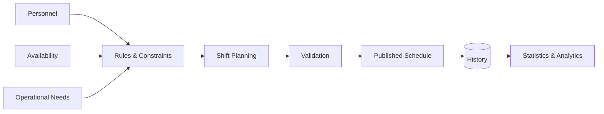

# Shift Planning & Workforce Management System

### Rule-driven workforce scheduling for complex municipal operations

 

 

---

## ✨ At a Glance

| | |
|---|---|
| 🏛️ **Context** | Complex municipal workforce operations |
| 🗓️ **Problem** | Shift planning under many interacting rules and constraints |
| 🧠 **Core Challenge** | Translating operational policy into maintainable scheduling logic |
| 📊 **Beyond Scheduling** | History, tracking, statistics and operational visibility |
| 🔐 **Public Version** | Synthetic data only |
| 🚀 **Demo** | Planned portfolio sandbox |

## 🔎 Why This Exists

A normal calendar can assign someone to a shift.

A real workforce system has to answer much harder questions:

- **Who is eligible?**
- **Which rules apply?**
- **What assignments conflict?**
- **How should workload be distributed?**
- **What happened historically?**
- **Can managers understand the result?**

That turns scheduling into a **constraint and business-rule problem**, not a simple CRUD workflow.

## ⚙️ Scheduling Flow

## ⚡ Core Capabilities

| Capability | Purpose |
|---|---|
| 🗓️ **Shift Planning** | Build and manage workforce schedules |
| 🧩 **Constraint Handling** | Apply operational and personnel restrictions |
| 👥 **Personnel Management** | Keep workforce context available to planners |
| ⚖️ **Workload Awareness** | Support fairer and more informed assignment decisions |
| 🕘 **Historical Tracking** | Preserve previous assignments and operational context |
| 📊 **Statistics** | Turn scheduling history into useful visibility |
| 🧑‍💼 **Administration** | Centralize planning workflows for authorized users |

## 🧠 Engineering Focus

The value of this project is in modelling a real operational domain.

Key engineering concerns include:

- Business-rule modelling
- Constraint-aware scheduling
- Data consistency
- Validation flows
- Historical records
- Reporting and analytics
- Maintainable domain architecture
- Administrative workflow design

> [!NOTE]
> The public version is intentionally separated from real municipal personnel information. Any future demo will contain **synthetic users and synthetic scheduling data only**.

## 🎬 Live Demo

**Coming soon.**

The public demo is planned as a recruiter-friendly sandbox showing representative scheduling rules and workflows without exposing production data.

## 🖼️ Product Showcase

| Planning | Personnel | Analytics |
|---|---|---|
| 🗓️ Coming soon | 👥 Coming soon | 📊 Coming soon |

A real workflow GIF will be added when the portfolio-safe build is ready.

## 🛣️ Project Status

- [x] Public case-study repository
- [x] Problem / solution narrative
- [x] Scheduling architecture overview
- [ ] Publish sanitized code
- [ ] Add real tech stack
- [ ] Add screenshots
- [ ] Add workflow GIF
- [ ] Document rule engine / domain model
- [ ] Deploy synthetic demo

## 💡 Why This Project Matters

This project demonstrates the ability to turn **messy, rule-heavy operational requirements** into a structured software system.

That means working beyond forms and database tables — understanding the domain, modelling constraints and designing software that remains understandable as complexity increases.

---

### Built by [Taha Kubilay](https://github.com/tahakubilay)

`Workforce Management` · `Scheduling` · `Business Rules` · `Enterprise Software` · `Analytics`

[⬆ Back to top](#shift-planning--workforce-management-system)

