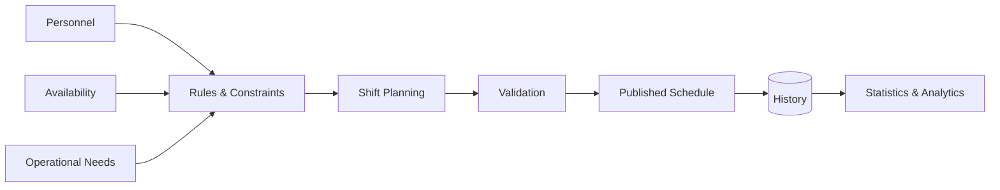

# Shift Planning & Workforce Management System

### Rule-driven workforce scheduling for complex municipal operations

<a href="./README.md"><strong>English</strong></a> · <a href="./README.de.md">Deutsch</a> · <a href="./README.tr.md">Türkçe</a>

  
  
  

---

## Overview

Shift Planning & Workforce Management System is designed for operational environments where scheduling is governed by many interacting rules, personnel constraints and organizational requirements.

Instead of treating scheduling as a simple calendar problem, the system models it as a business-rule and constraint-management problem. It brings workforce planning, validation, historical tracking and operational visibility into a single workflow.

## Core Challenges

A real workforce planning system must answer questions such as:

- Who is eligible for a given shift?
- Which personnel and operational rules apply?
- Which assignments conflict with existing constraints?
- How should workload be distributed?
- What historical context should influence planning?
- How can managers review and understand the resulting schedule?

## Scheduling Flow

## Core Capabilities

| Capability | Purpose |
|---|---|
| **Shift Planning** | Create and manage workforce schedules |
| **Constraint Handling** | Apply operational and personnel restrictions |
| **Personnel Management** | Keep relevant workforce context available during planning |
| **Workload Awareness** | Support balanced and informed assignment decisions |
| **Historical Tracking** | Preserve previous assignments and operational context |
| **Statistics & Analytics** | Turn scheduling history into operational insight |
| **Administration** | Centralize planning workflows for authorized users |

## Engineering Focus

The project focuses on modelling a rule-heavy operational domain in a way that remains understandable and maintainable as complexity grows.

Key engineering concerns include:

- Business-rule modelling
- Constraint-aware scheduling
- Data consistency
- Validation workflows
- Historical records
- Reporting and analytics
- Maintainable domain architecture
- Administrative workflow design

## Live Demo

The deployed application can be explored directly:

### **[→ Open Shift Planning System](https://shift-planning-system-drab.vercel.app/takvim)**

The demo environment uses synthetic users and synthetic scheduling data. No real municipal personnel records are included in the public deployment.

## Data & Privacy

This repository and its public demo are intentionally separated from real operational personnel data. Public-facing examples use synthetic data so the system can be demonstrated without exposing private records.

---

### Built by [Taha Kubilay](https://github.com/tahakubilay)

`Workforce Management` · `Scheduling` · `Business Rules` · `Enterprise Software` · `Analytics`

