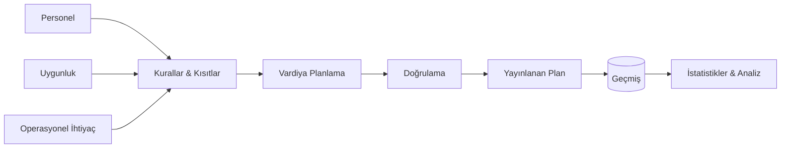

# Vardiya Planlama & İş Gücü Yönetim Sistemi

### Karmaşık belediye operasyonları için kural tabanlı vardiya planlama

<a href="./README.md">English</a> · <a href="./README.de.md">Deutsch</a> · <a href="./README.tr.md"><strong>Türkçe</strong></a>

  
  
  

---

## Genel Bakış

Vardiya Planlama & İş Gücü Yönetim Sistemi; planlamanın çok sayıda birbiriyle ilişkili kural, personel kısıtı ve operasyonel gereksinim tarafından belirlendiği çalışma ortamları için tasarlanmıştır.

Sistem vardiya planlamayı yalnızca bir takvim problemi olarak ele almak yerine, iş kuralları ve kısıt yönetimi problemi olarak modeller. Personel planlama, doğrulama, geçmiş takibi ve operasyonel görünürlük tek bir akışta bir araya gelir.

## Temel Problemler

Gerçek bir iş gücü planlama sistemi şu sorulara cevap verebilmelidir:

- Belirli bir vardiya için kim uygundur?
- Hangi personel ve operasyon kuralları geçerlidir?
- Hangi atamalar mevcut kısıtlarla çakışır?
- İş yükü nasıl dağıtılmalıdır?
- Planlama sırasında hangi geçmiş bilgiler dikkate alınmalıdır?
- Yöneticiler ortaya çıkan planı nasıl inceleyip anlayabilir?

## Planlama Akışı

## Temel Yetenekler

| Yetenek | Amaç |
|---|---|
| **Vardiya Planlama** | İş gücü planlarını oluşturmak ve yönetmek |
| **Kısıt Yönetimi** | Operasyonel ve personel kısıtlarını dikkate almak |
| **Personel Yönetimi** | Planlama sırasında gerekli personel bağlamını sunmak |
| **İş Yükü Farkındalığı** | Dengeli ve bilinçli atama kararlarını desteklemek |
| **Geçmiş Takibi** | Önceki atamaları ve operasyonel bağlamı korumak |
| **İstatistik & Analiz** | Planlama geçmişini operasyonel içgörüye dönüştürmek |
| **Yönetim** | Yetkili kullanıcılar için planlama süreçlerini merkezileştirmek |

## Mühendislik Odağı

Projenin odağı, yoğun iş kurallarına sahip gerçek bir operasyonel alanı karmaşıklık arttıkça anlaşılır ve sürdürülebilir kalacak şekilde modellemektir.

Başlıca mühendislik konuları:

- İş kuralı modelleme
- Kısıt farkındalıklı planlama
- Veri tutarlılığı
- Doğrulama akışları
- Geçmiş kayıtlar
- Raporlama ve analiz
- Sürdürülebilir domain mimarisi
- Yönetim workflow tasarımı

## Canlı Demo

Yayındaki uygulama doğrudan incelenebilir:

### **[→ Shift Planning System'i Aç](https://shift-planning-system-drab.vercel.app/takvim)**

Demo ortamı yalnızca sentetik kullanıcılar ve sentetik vardiya verileri kullanır. Public deployment içinde gerçek belediye personel kayıtları bulunmaz.

## Veri & Gizlilik

Bu repository ve public demo, gerçek operasyonel personel verilerinden bilinçli olarak ayrılmıştır. Sistemin özellikleri özel kayıtlar açığa çıkarılmadan gösterilebilmesi için public örneklerde sentetik veri kullanılır.

---

### Geliştiren: [Taha Kubilay](https://github.com/tahakubilay)

`Workforce Management` · `Scheduling` · `Business Rules` · `Enterprise Software` · `Analytics`

