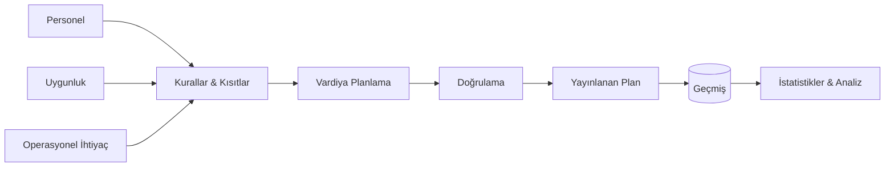

# Vardiya Planlama & İş Gücü Yönetim Sistemi

### Karmaşık belediye operasyonları için kural tabanlı vardiya planlama

<a href="./README.md">English</a> · <a href="./README.de.md">Deutsch</a> · <a href="./README.tr.md"><strong>Türkçe</strong></a>

  
  
  
  

---

## ✨ Kısaca

| | |
|---|---|
| 🏛️ **Bağlam** | Karmaşık belediye personel operasyonları |
| 🗓️ **Problem** | Birbiriyle etkileşen çok sayıda kural ve kısıt altında vardiya planlama |
| 🧠 **Ana Zorluk** | Operasyonel politikaları sürdürülebilir planlama mantığına dönüştürmek |
| 📊 **Planlamanın Ötesi** | Geçmiş kayıtlar, takip, istatistikler ve operasyonel görünürlük |
| 🔐 **Public Sürüm** | Yalnızca sentetik veri |
| 🚀 **Canlı Demo** | [Yayındaki planlama arayüzünü aç](https://shift-planning-system-drab.vercel.app/takvim) |

## 🔎 Bu Sistem Neden Var?

Normal bir takvim birini vardiyaya atayabilir.

Gerçek bir iş gücü sistemi ise çok daha zor sorulara cevap vermelidir:

- **Kim bu vardiya için uygun?**
- **Hangi kurallar geçerli?**
- **Hangi atamalar birbiriyle çakışıyor?**
- **İş yükü nasıl dağıtılmalı?**
- **Geçmişte ne oldu?**
- **Yöneticiler sonucu anlayabiliyor mu?**

Bu nedenle vardiya planlama basit bir CRUD süreci değil, **kısıt ve iş kuralı problemidir**.

## ⚙️ Planlama Akışı

## ⚡ Temel Yetenekler

| Yetenek | Amaç |
|---|---|
| 🗓️ **Vardiya Planlama** | İş gücü planlarını oluşturmak ve yönetmek |
| 🧩 **Kısıt Yönetimi** | Operasyonel ve personel kısıtlarını uygulamak |
| 👥 **Personel Yönetimi** | Planlamacılara gerekli personel bağlamını sunmak |
| ⚖️ **İş Yükü Farkındalığı** | Daha adil ve bilinçli atama kararlarını desteklemek |
| 🕘 **Geçmiş Takibi** | Önceki atamaları ve operasyonel bağlamı saklamak |
| 📊 **İstatistikler** | Planlama geçmişini anlamlı görünürlüğe dönüştürmek |
| 🧑‍💼 **Yönetim** | Yetkili kullanıcılar için planlama akışlarını merkezileştirmek |

## 🧠 Mühendislik Odağı

Bu projenin asıl değeri gerçek bir operasyonel alanı doğru modellemektir.

Önemli mühendislik başlıkları:

- İş kuralı modelleme
- Kısıt farkındalıklı planlama
- Veri tutarlılığı
- Doğrulama akışları
- Geçmiş kayıtlar
- Raporlama ve analiz
- Sürdürülebilir domain mimarisi
- Yönetim workflow tasarımı

> [!NOTE]
> Public sürüm gerçek belediye personel bilgilerinden bilinçli olarak ayrılmıştır. Gelecekteki demo yalnızca **sentetik kullanıcılar ve sentetik vardiya verileri** içerecektir.

## 🌐 Canlı Demo

Planlama arayüzü şu anda yayında ve doğrudan incelenebilir:

### **[→ Shift Planning System'i Aç](https://shift-planning-system-drab.vercel.app/takvim)**

Canlı route doğrudan takvim / vardiya planlama çalışma alanını açar. Böylece projeyi clone etmeden veya lokal kurulum yapmadan ürün deneyimi incelenebilir.

> [!NOTE]
> Public deployment portföy gösterimi içindir. Gerçek belediye personel verileri demo üzerinden hiçbir zaman yayınlanmamalıdır.

## 🖼️ Canlı Ürün Görselleri

### Demo Girişi — Tutorial Kapalı

Görüntü alınmadan önce tutorial/rehber katmanları kapatılır; böylece arayüz temiz haliyle gösterilir.

### Desktop — Takvim / Planlama Çalışma Alanı

### Mobil — Responsive Görünüm

Bu görüntüler repository içindeki Playwright screenshot workflow'u tarafından doğrudan yayındaki Vercel uygulamasından alınır. Böylece portföy görselleri yeniden çizilmiş mockup'lardan değil, gerçek çalışan üründen gelir.

## 🛣️ Proje Durumu

- [x] Public case-study reposu
- [x] Problem / çözüm anlatımı
- [x] Planlama mimarisi özeti
- [ ] Temizlenmiş kaynak kodu yayınla
- [ ] Gerçek teknoloji yığınını ekle
- [x] Otomatik canlı ekran görüntülerini ekle
- [ ] Workflow GIF'ini ekle
- [ ] Rule engine / domain modelini belgele
- [x] Public portföy demosunu deploy et

## 💡 Bu Proje Neden Önemli?

Bu proje, **karmaşık ve yoğun kurallı operasyonel gereksinimleri** yapılandırılmış bir yazılım sistemine dönüştürme becerisini gösterir.

Yalnızca form ve veritabanı geliştirmek değil; alanı anlamak, kısıtları modellemek ve karmaşıklık arttıkça anlaşılır kalabilen bir sistem tasarlamak söz konusudur.

---

### Geliştiren: [Taha Kubilay](https://github.com/tahakubilay)

`Workforce Management` · `Scheduling` · `Business Rules` · `Enterprise Software` · `Analytics`

